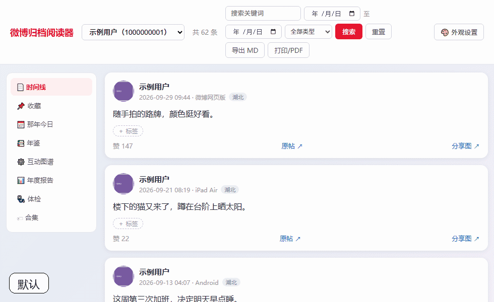
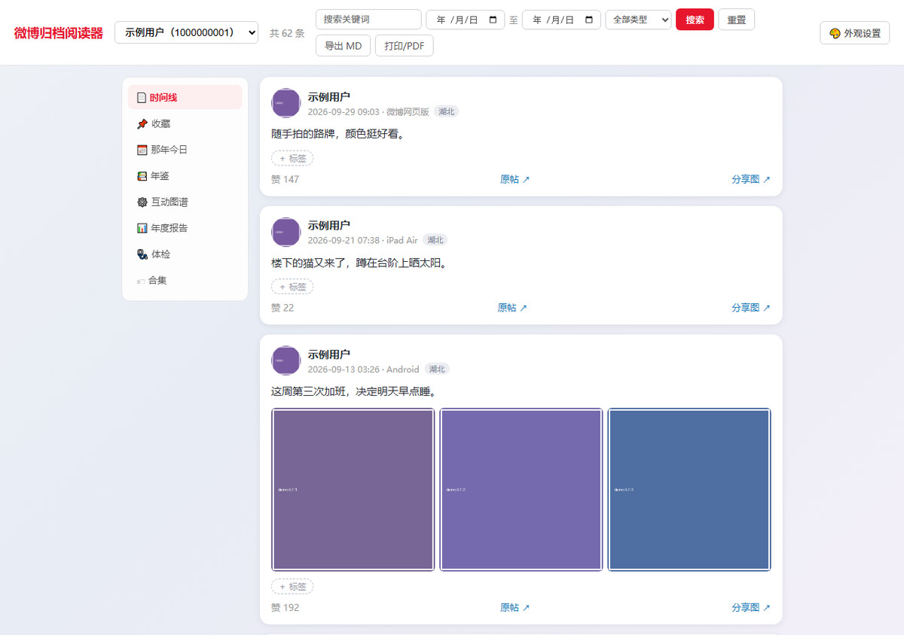
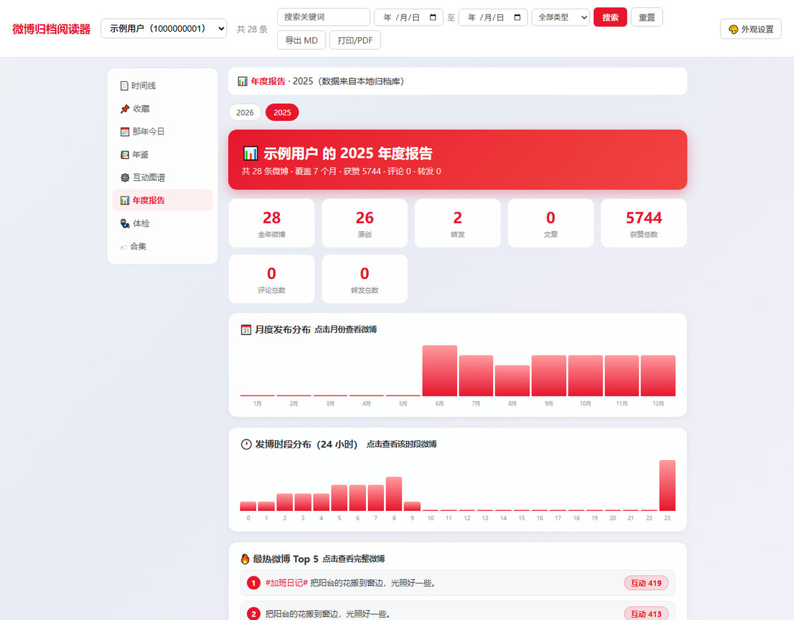
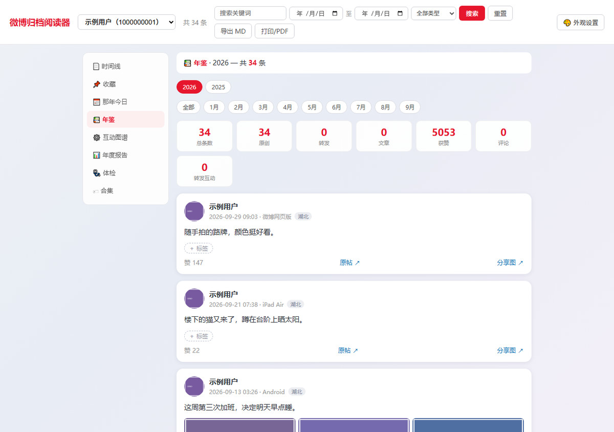
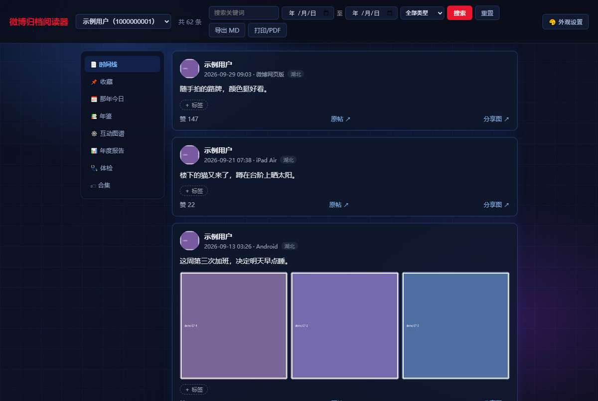
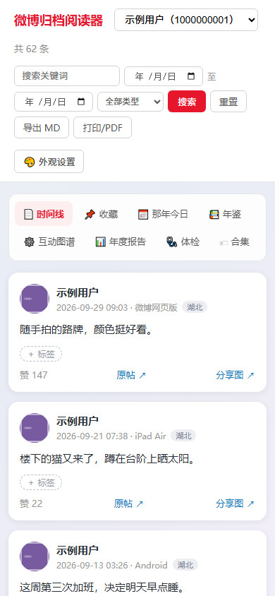

# 微博归档阅读器 · Weibo Archive Reader

把 [weibo-crawler](https://github.com/dataabc/weibo-crawler) 备份下来的微博库，
渲染成能在浏览器里翻的站点：时间线、全文搜索、年鉴、互动图谱、年度报告、收藏、体检、导出、手机访问。
数据存在本地的 SQLite 里，服务不联网。

**适合谁**：准备删号但想留档的、想多年以后翻回来看的、想把某段记录整理好给别人的。
不适合当社交产品用——它只读，不能发微博，也不替你上传任何东西。

> 本项目基于 [kyuumm/WeiboArchive](https://github.com/kyuumm/WeiboArchive)（MIT）修改，
> 后者源自 [YaoZeyuan/stablog](https://github.com/YaoZeyuan/stablog)（MIT）。原始界面与数据结构来自这两位作者。

---

## 三步开始（Windows，双击就行）

| 顺序 | 双击 | 作用 |
|---|---|---|
| 0 | `0-环境检查.bat` | 检查 Python 和依赖是否已安装（可选） |
| 1 | `1-安装依赖.bat` | 安装 flask / pillow / jieba |
| 2 | `2-生成示例数据.bat` | 生成 20 条假数据，先看界面 |
| 3 | `3-启动阅读器.bat` | 启动服务并打开浏览器 |

> 没装 Python？到 <https://www.python.org/downloads/> 下载 3.9 以上版本，
> 安装时勾选 "Add python.exe to PATH"。

> 想把这份代码放到自己的 GitHub 仓库？在网页上新建一个空仓库，然后
> `git init && git add -A && git commit -m init && git push` 就行。
> 仓库里没有附自动上传脚本：发布是一次性动作，不必每个下载的人都跟着做一遍。

命令行等价操作：

```bash
pip install -r requirements.txt
python tools/make_demo_db.py
python run.py
```

打开 <http://127.0.0.1:5055> 就能看到界面。

## 界面

下面全部是 `tools/make_demo_db.py` 生成的**假数据**，没有使用任何真实微博内容。

外观可以逐项调：26 种卡片主题、字体（含本地字体）、字号、内容宽度。下面是切换主题的样子：



时间线：卡片排版，图片按原比例显示，右侧是年份/月份导航之外的固定侧栏。



年度报告：月度分布、24 小时时段分布、最热微博、高频词云。



年鉴：按月归档，顶部是这一年的统计（总条数、原创、转发、获赞……）。



外观：26 种网页背景 × 25 种卡片风格可以自由混搭，也可以锁定成同一套。下图是「科技」主题。



手机：`HOST` 改成 `0.0.0.0` 后同一 WiFi 直接打开，支持添加到主屏。



## 换成你自己的数据

阅读器读 weibo-crawler 的 SQLite 库，用到 `user` / `weibo` / `comments` / `reposts` 四张表。

1. 复制 `config.example.py`，改名为 `config.py`
2. 填两行：

   ```python
   DATA_DIR  = r"D:/weibo-reader-data"     # 阅读器工作目录（库、表情、背景图）
   DATA_ROOT = r"D:/MyWeiboArchive"       # 爬虫归档目录（图片视频直接从这里读）
   ```

3. 把 `weibo.db` 放进 `DATA_DIR`，双击 `3-启动阅读器.bat`

图片目录名要和 `user.nick_name` 一致，爬虫默认就是这么存的。

## 数据从哪来（weibo-crawler）

阅读器自己不抓微博，数据来自 [weibo-crawler](https://github.com/dataabc/weibo-crawler)。
安装和参数说明以它的 README 为准，这里只写和本文档衔接的部分。

1. 在爬虫的 `config.json` 里至少确认四项：

   | 字段 | 填什么 |
   |---|---|
   | `user_id_list` | 要备份的账号 **uid**（数字，不是昵称） |
   | `cookie` | 浏览器登录微博后的 Cookie |
   | `output_directory` | 产出目录，默认 `MyWeiboArchive` |
   | `write_mode` | **必须包含 `sqlite`**，否则不会生成 `weibo.db` |

2. 跑一次爬虫，产出大致长这样：

   ```
   MyWeiboArchive/
   ├── weibo.db              ← 阅读器要的就是这个文件
   ├── users.csv
   ├── <昵称>/img/…          ← 主账号的图片
   └── <uid>/…               ← 转发原帖作者的头像和图片
   ```

3. 把 `weibo.db` 复制到阅读器的 `DATA_DIR`，`DATA_ROOT` 指向上面的 `MyWeiboArchive`。

几个容易踩的点：

- `download_comment = 1` 会让抓取明显变慢（每条微博都要多请求一次）；只想先看正文可以先关掉
- `incremental_mode = 1` 建议开启，第二次跑只补新增，不会重抓整库
- `cookie` 会过期，实测大约 3 天。典型症状是爬虫反复打印 `Expecting value: line 1 column 1 (char 0)`：不是数据坏了，是未登录时接口返回整页 HTML，解析失败。重新复制一次 Cookie 即可（想先确认，请求 `https://m.weibo.cn/api/config`，看到 `"login":false` 就是过期了）
- 账号目录名可能是昵称也可能是 uid（`user_id_as_folder_name` 控制），阅读器两种都认

不想装爬虫也行：只要 `weibo.db` 里有 `user` / `weibo` / `comments` / `reposts` 四张表，
放进 `DATA_DIR` 就能读，字段含义见 [AGENT.md](AGENT.md)。

## 想放到手机上 / 平板上看

`config.py` 里把 `HOST` 改成 `"0.0.0.0"`，重启后控制台会打印局域网地址，
手机连同一个 WiFi 就能打开；需要口令就设 `ACCESS_CODE`。

## 为什么仓库里没有表情图

微博的表情图是新浪的版权素材，打包进仓库属于侵权，所以本仓库只提供抓取脚本：

```bash
python tools/fetch_emoji.py --wid <一条能正常显示表情的微博ID>
```

`data/`、`*.db`、`config.py` 也不在仓库里。除了版权，还因为那里存着别人的微博正文。
`.gitignore` 已经把这些都排除，正常提交不会带上。

## 用 AI 助手帮你部署

仓库里有一份 [AGENT.md](AGENT.md)，写了环境、命令和常见错误，是给 AI 助手读的。
把整个文件夹交给助手，让它先看 AGENT.md。

## 功能

| 模块 | 说明 |
|---|---|
| 时间线 | 卡片排版、图片按原比例显示、点击放大、← → 翻页、已读标记与“续读” |
| 全文搜索 | SQLite FTS5（trigram），中文子串可搜；1–2 字自动退回 LIKE |
| 年鉴 / 年度报告 / 互动图谱 / 那年今日 | 按年归档、发帖曲线、互动关系、往年今天发过什么 |
| 收藏 / 标签合集 | 收藏分组；给任意微博打标签，按标签回看 |
| 体检 | 统计缺图、缺视频、缺原帖、孤儿文件、评论缺属地的条数，可点进对应时间点 |
| 导出 | 按账号或年份导出 Markdown；单条微博生成分享图 |
| 外观 | 26 种网页背景 × 25 种卡片风格，可锁定联动；字号、宽度、字体可调，字体支持本机任意一款 |
| 手机 | 局域网访问、PWA 添加到主屏、可选访问口令 |

## 配置项

| 键 | 默认 | 说明 |
|---|---|---|
| `DATA_DIR` | `<仓库>/data` | 数据目录：`weibo.db`、`emoji/`、`bg/` |
| `DATA_ROOT` | 空 | 爬虫归档目录；留空时只用 `DATA_DIR/img`、`DATA_DIR/video` |
| `HOST` | `127.0.0.1` | 改成 `0.0.0.0` 允许手机访问 |
| `PORT` | `5055` | 端口 |
| `ACCESS_CODE` | 空 | 非本机访问的口令；留空不校验 |

也可以用环境变量 `WEIBO_DATA_DIR` 覆盖数据目录，方便在几份备份之间切换。

## 目录结构

```
weibo-archive-reader/
├── 0-环境检查.bat / 1-安装依赖.bat / 2-生成示例数据.bat / 3-启动阅读器.bat
├── run.py                 启动入口
├── config.example.py      配置模板
├── weibo_reader/
│   ├── paths.py           路径解析
│   ├── core.py            配置 / 数据库 / 文本与表情渲染 / FTS
│   ├── render.py          单条微博与卡片渲染
│   ├── views.py           年鉴 / 报告 / 图谱 / 体检 / 合集
│   └── routes.py          Flask 应用与全部接口
├── docs/screenshots/      界面截图（演示数据）
├── static/                app.css / app.js / manifest / 图标
└── tools/
    ├── make_demo_db.py    生成示例库
    ├── make_theme_gif.py  重新生成主题切换动图（需本机 Chrome）
    └── fetch_emoji.py     抓取表情图（可选）
```

## 已知限制

- 微博历史联名表情（小黄人、复仇者联盟、星球大战等）网页端已停止渲染，抓不到地址，见上文「为什么仓库里没有表情图」
- 本地没有存下来的图片，页面会把微博的图床地址直接写进 ``，由浏览器去新浪加载；要完全离线，得先跑抓图脚本
- “炸号”账号的微博在网页端不可见，需要账号本人的登录态才能补全
- 依赖 weibo-crawler 的库结构，上游改表需要同步调整

## 致谢

[YaoZeyuan/stablog](https://github.com/YaoZeyuan/stablog) ·
[kyuumm/WeiboArchive](https://github.com/kyuumm/WeiboArchive) ·
[dataabc/weibo-crawler](https://github.com/dataabc/weibo-crawler)

## License

[MIT](LICENSE)
